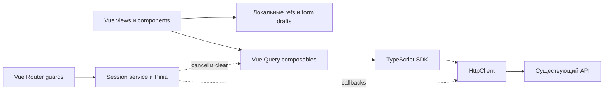

# План миграции Firefly Commander на Vue 3

Перенести весь действующий интерфейс из `../firefly-commander` в самостоятельное Vue 3 SPA в `55north-commander`, сохранив маршруты, бизнес-правила, API-контракты, брендинг и пользовательские сценарии. Переписать слой React-компонентов и интеграции с фреймворком, переиспользовать TypeScript SDK, вычисления и стили. Переключать пользователей после достижения функционального соответствия и проверки отката.

**Основной стек:** Vue 3 с Composition API и TypeScript, Vite, Vue Router, Pinia, TanStack Vue Query, Tailwind CSS 4, Reka UI для сложных интерактивных элементов, существующий Chart.js. Это самостоятельный фронтенд к существующему API; Nuxt и SSR для текущего приложения не нужны.

План основан на состоянии рабочего дерева на **8 октября 2026 года**. Исходный HEAD — `e230b700b53820286bb923e3c968e86d5c61cbe4`. Файлы имеют локальные изменения по `git status`, поэтому HEAD недостаточно для воспроизводимости: точные хеши и решения по файлам находятся в [source-inventory.json](migration/source-inventory.json). Планирование выполнено статически; действующая сборка и браузерные тесты должны быть зафиксированы на этапе M0.

**Статус исполнения на 8 октября 2026:** основные экраны и инфраструктура перенесены, оба бренда собраны. Галочки ниже отражают выполненную работу и локальные проверки; M9/M10 целиком не закрыты. Подробные доказательства, частичные сценарии и оставшиеся ручные/production действия — в [IMPLEMENTATION_STATUS.md](migration/IMPLEMENTATION_STATUS.md), [матрице](migration/acceptance-matrix.md) и [решениях/исправлениях](migration/DECISIONS_AND_FIXES.md). CI workflow подготовлен, remote execution не подтверждён. Rollback rehearsal выполнен на локальном изолированном стенде.
## Объём миграции

В текущем `src` находятся **93 файла и 12 381 строка**: 54 TSX, 38 TS, один CSS. В `tests/e2e` — пять файлов и пять крупных Playwright-сценариев. Исходный README описывает начальный инфраструктурный каркас и не отражает уже реализованные экраны.

| Область | Что действительно реализовано | Решение |
| --- | --- | --- |
| Авторизация | Login, access/refresh token, `/auth/me`, persisted session, logout | Перенести с отдельной проверкой гонок и восстановления сессии |
| Доступ | Route guards и меню по privileges | Сохранить текущую матрицу прав |
| Пилоты | Поиск, фильтры, сортировка, пагинация, авторизованные фото | Полный перенос |
| Профиль пилота | Вкладки, общая информация, последнее обучение, radar, история оценок, завершённые сессии | Полный перенос |
| Тренировки | Список, автокомплиты, даты, группировка дней | Полный перенос |
| Детали тренировки | Участники, смена состава экипажа, PF/PM, попытки, комментарии, AI review, печать PDF | Полный перенос текущего поведения |
| Аналитика | Четыре группы запросов, графики распределений и тренда, фильтры пилотов и инструкторов | Переносить вместе с алгоритмами вычисления |
| Совместимость | Два пилота, тип тренировки, дата, пороги и статусы | Полный перенос |
| Настройки | CRUD типов тренировок, основной тип, пороги компетенций, независимые черновики | Полный перенос |
| Служебные страницы | Forbidden и небольшой privilege-gated Admin | Сохранить; Admin сейчас не является полноценным CRUD пользователей |
| Инфраструктура | Два бренда, частичная локализация, Sentry/GlitchTip, GitHub Actions и Nginx | Адаптировать и проверить |

Статический граф импортов от `main.tsx`, включая type imports, достигает 83 файлов. Десять остальных — кандидаты на исключение: `entities/ai/*`, `entities/support/api.ts`, `entities/training/constraints.ts`, `shared/forms/fieldConstraints.ts`, `features/analytics/ui/AnalyticsSummaryCards.tsx`, `shared/ui/icons/{MailIcon,SuitcaseIcon}.tsx`, их `index.ts` и `views/CommanderHomeView.tsx`. Для каждого есть запись в инвентаризации. Отсутствие импорта не означает, что можно удалить одноимённую функцию из действующего продукта без проверки: например, **AI review в деталях тренировки используется**, хотя отдельный `entities/ai/api.ts` не используется.

В scope не входят новые бизнес-функции, редактор сценариев из `firefly-session`, полноценная админка, переработка backend, полный перевод приложения, новый дизайн или мобильное приложение. Существующие заглушки сохраняются в их текущем объёме. Неиспользуемый SDK не превращается в задачу реализации отсутствующих экранов.

## Зафиксированные решения и допущения

1. Разрабатывать новую версию в этой папке. React-приложение остаётся доступным как эталон и артефакт отката. Гибрид React/Vue внутри одного runtime не вводить: размер и разделение проекта позволяют миграцию по законченной функциональности в отдельной сборке.
2. Контракт `/api` сохраняется. Фронтенд не должен определять Python или Go за API. Само имя `55north-commander` не является основанием менять сервер, DTO или доступы.
3. Сохранить оба бренда, `firefly` и `55nord`. Для первого целевого выпуска использовать конфигурацию `55nord`; имя репозитория `55north` не менять в runtime brand ID. Привязка релиза к конкретному домену уточняется при подготовке окружения.
4. Сохранить текущую компоновку, подписи, цвета и основные размеры. UI-библиотека заменяет поведение контролов; допустимые визуальные отличия фиксировать на конкретных экранах.
5. Оставить npm и единый `package-lock.json`. Не совмещать перенос с изменением менеджера пакетов.
6. Сохранить существующий формат persisted session до завершения периода отката. Перенос на cookies или другой механизм авторизации — отдельное изменение API и инфраструктуры.
7. Сохранить существующую AI review panel. В соседнем backend есть подготовленный [отдельный patch без AI](../55north-backend/migration/evidence/client-a0-commander/README.md), но это не применённая спецификация исходного фронта. Если целевой продукт должен использовать вариант без AI, изменить scope до M4 и обновить приёмку; не применять patch автоматически и не считать его проверки проверками этой миграции.

## Выбор технологий

| Слой | Целевое решение | Основание |
| --- | --- | --- |
| Представление | Vue 3, SFC, `<script setup lang="ts">` | Явные props/emits, перенос функций и типов без JSX |
| Сборка | Vite и `@vitejs/plugin-vue` | Сохранение SPA и структуры статического деплоя |
| Маршрутизация | Vue Router, history mode, lazy route imports | Те же URL, nested routes, централизованные guards |
| Состояние сессии | Pinia | Единственный владелец tokens, user и auth status |
| Серверное состояние | `@tanstack/vue-query` | Близкая модель query keys, retry, invalidation и placeholder data |
| UI и CSS | Tailwind 4 плюс Reka UI | Сохранение своих токенов; готовые механизмы combobox и dialog |
| Графики | Chart.js 4, начальная версия 4.5.1 как у источника | Сохранение вычислений, plugins, tooltip и качества canvas |
| HTTP | Существующий `HttpClient` на fetch | Сохранение refresh, ошибок, blob и serialization; Axios не добавлять |
| Формы | Vue `ref`/`computed`, существующие validators | Формы достаточно небольшие; новый validation framework не обязателен |
| Локализация | `vue-i18n`, Composition API | Перенос существующих `en`/`ru` ресурсов и fallback |
| Ошибки | `@sentry/vue` и собственный Vue error fallback | Сохранение наблюдаемости и пользовательского восстановления |
| Unit и component | Vitest, Vue Test Utils, jsdom | Проверка доменных правил и Vue-интеграций |
| Браузерные проверки | Существующий Playwright | Перенос пользовательских контрактов независимо от фреймворка |

SFC, TypeScript, Router, Pinia и тесты входят в поддерживаемый путь настройки через [официальный create-vue](https://vuejs.org/guide/quick-start.html). Создавать scaffold на M1 во временной папке и переносить нужные файлы: `55north-commander` уже содержит Git и документы, которые генератор не должен затереть.

Для runtime сборки выбрать **Node.js 24 LTS**, зафиксировать конкретную совместимую patch-версию в `.node-version` или `.nvmrc`, `engines` и CI. Источник использует Node 20 в workflow; актуальная таблица [Node.js Releases](https://nodejs.org/en/about/previous-releases) позволяет выбрать поддерживаемую ветку. Точные версии Vue, Vite, Router, Pinia, Reka UI и тестовых пакетов закрепить вместе после проверки `engines`/peer dependencies на M1. Не использовать плавающий `latest` в воспроизводимой CI. Отдельную major-модернизацию Chart.js и Tailwind не совмещать с переносом.

### Применение UI библиотеки

Reka UI предоставляет компоненты без предписанных стилей и механизмы управления фокусом и клавиатурой; это соответствует существующему Tailwind-интерфейсу. См. [описание Reka UI](https://reka-ui.com/docs/overview/introduction).

| Текущий элемент | Целевая реализация | Что сохранить |
| --- | --- | --- |
| `AutocompleteSelect.tsx` | `AutocompleteSelect.vue` поверх Reka Combobox | Поисковую строку отдельно от выбранного объекта, async options, loading, empty, disabled, метаданные строк |
| Подтверждение удаления типа | Сначала существующий confirm либо `ConfirmDialog.vue` на Reka AlertDialog | Явное подтверждение, название удаляемого типа, cancel без запроса |
| Простой select | Нативный `<select>` в небольшой Vue-обёртке | Числовые ID, nullable selection, подписи и существующую семантику тестов |
| Даты | Нативный `<input type="date">` | Строку `YYYY-MM-DD` без пересчёта в UTC |
| Порог компетенции | Текстовый input с `inputmode="decimal"` | Промежуточные строки `0.`, четыре знака, пустое значение и явный ноль |
| Кнопки, badge, error, skeleton | Небольшие собственные Vue-компоненты и Tailwind | Текущие токены и размеры |
| Списки и таблицы | Собственные `PilotsList.vue`, `TrainingSessionsList.vue` | Группировку, ссылки, фото, sticky horizontal scroll |
| Tabs профиля | `RouterLink` и вложенный `RouterView` | Прямые URL вкладок и историю браузера |
| Внутренние tabs | Простые Vue tabs или Reka Tabs | Управляемый выбор и ARIA semantics |

Для remote search у [Reka Combobox](https://reka-ui.com/docs/components/combobox) отключить повторную внутреннюю фильтрацию через `ignoreFilter`: сервер уже ищет по имени, login и email. Иначе найденный по email пользователь может исчезнуть из списка, где видимое имя не совпадает с запросом. Portal должен корректно располагаться относительно scroll-container приложения.

PrimeVue рассматривался как альтернатива для более стандартного административного интерфейса. Здесь библиотечная DataTable не заменяет основную доменную работу и может усложнить сохранение текущих группировок. Кроме того, актуальная [ветка PrimeVue 5](https://primevue.dev/migration/v5/) отличается от часто встречающихся примеров v4, включая модель распространения и ряд API. Поэтому основной план фиксирует Reka UI; не нужно смешивать два набора UI-компонентов. Платные шаблоны и компоненты для этой миграции не требуются.

### Зависимости исходника

- Убрать из нового проекта React, React DOM, React Router, Zustand, React Query adapter/devtools, React i18next adapter, Sentry React SDK, React types и ESLint plugins, `@vitejs/plugin-react`.
- В `src` не обнаружено импортов `primereact`, `primeicons`, `@dnd-kit/*` и `quill`, хотя они есть в `package.json`. Не включать их в новую установку.
- Сохранить Chart.js, Tailwind и TypeScript; Playwright переносится как тестовый инструмент. Новый lockfile строится из Vue manifest, а исходный остаётся частью baseline.
- VueUse, schema validators, form libraries и chart wrappers добавлять только под конкретную сложность. Два небольших composable для debounce и media не требуют отдельной библиотеки.
- Не переносить старые `node_modules`, `dist`, кеши ESLint, реальные `.env` и результаты тестов.

## Целевая структура приложения

Сохранить узнаваемые `views`, `features`, `entities`, `shared`, `widgets`. Это снижает объём переименований и позволяет сопоставлять реализацию с исходником.

```text
src/
  main.ts
  App.vue
  app/
    router.ts
    guards.ts
    bootstrap.ts
    providers/queryClient.ts
  entities/
    session/{api,types,privileges,utils,store,persistence}.ts
    commander/{api,types,queryKeys}.ts
    training/                         # используемые DTO и lookup SDK
    users/                            # positions lookup и типы
  features/
    pilots/{composables,ui}/
    pilot-profile/{composables,lib,ui}/
    training-sessions/{composables,lib,ui}/
    training-session-detail/{composables,lib,ui}/
    analytics/{composables,lib,ui}/
    compatibility/{composables,lib,ui}/
    settings/{composables,lib,ui}/
  shared/
    api/{api,requestExecutor,endpoints}.ts
    config/env.ts
    branding/{brand.ts,BrandLogo.vue}
    i18n/{index.ts,messages/}
    monitoring/sentry.ts
    lib/{media,useDebouncedValue.ts}/
    ui/{inputs,dialogs,lists,charts,chips}/
  widgets/layout/
    AppShell.vue
    ui/{AppHeader,AppSidebar}.vue
  views/                              # counterparts текущих route views
  styles.css
tests/
  unit/
  component/
  e2e/
  fixtures/
migration/
  source-inventory.json
  acceptance-matrix.md
  evidence/                           # появится при выполнении этапов
```

Направление зависимостей: views собирают features и entities; features используют SDK и shared UI; DTO и вычисления не импортируют компоненты. Новые composables держат orchestration, а `lib` — вычисления без реактивного состояния. Специальный composition root создаёт store, HTTP client, QueryClient и router; HTTP transport не должен импортировать Pinia напрямую.



| Вид состояния | Владелец | Правило |
| --- | --- | --- |
| Tokens, user, privileges, bootstrap status | Pinia session store | Проверять профиль через сервер; не считать persisted privileges доказательством доступа |
| Данные API, loading/error, серверный кеш | Vue Query | Не дублировать списки, summary и analytics в Pinia |
| Фильтры, открытые панели, выбор пилота/оценки | Локальные `ref` и `computed` | Повторить текущие default/reset semantics |
| Несохранённые настройки | Feature-local drafts по `flightTypeId` | Не привязывать `v-model` к кешированному объекту API |
| Object URLs, Chart instances, DOM observers | Composable или UI adapter | Явное создание и освобождение ресурсов |

## Маршруты и права

Все пути ниже должны открываться напрямую, переживать refresh и поддерживать Back/Forward. У приложения сейчас нет отдельного `/login`: без сессии `App` показывает форму на запрошенном URL. Сохранить этот контракт и возвращение к запрошенной странице после login.

| URL | Экран или действие | Требуемые privileges |
| --- | --- | --- |
| `/` | Redirect на `/pilots`, replace | Далее проверка пилотов |
| `/pilots` | Список пилотов | `pilots:read` |
| `/pilots/:pilotId` | Layout профиля, redirect на `training-data` | `pilots:read` |
| `/pilots/:pilotId/training-data` | Обучение и графики | `pilots:read` |
| `/pilots/:pilotId/profile` | Общая информация | `pilots:read` |
| `/training-sessions` | Список тренировок | `pilots:read` |
| `/training-sessions/:trainingSessionId` | Детали тренировки | `pilots:read` |
| `/analytics` | Аналитика | `pilots:read` |
| `/compatibility` | Совместимость | `pilots:read` |
| `/settings` | Типы тренировок и пороги | `pilots:read` |
| `/admin` | Существующая служебная страница | `users:read` |
| `/forbidden` | Отказ в доступе внутри shell | Без дополнительного privilege после auth |
| Любой неизвестный путь | Redirect на `/pilots`, replace | Далее обычная проверка |

В исходнике для Settings дважды указан `PILOTS_READ`; дубликат удалить без изменения политики. Не заменять его на `training:write` по предположению: реальную политику write-доступа сверить с целевым API на M0. Frontend guards не заменяют серверную проверку прав.

Guards ждут один общий bootstrap promise и затем проверяют `to.matched`/route meta с семантикой **all privileges**. Sidebar использует ту же конфигурацию доступа. При отсутствии tokens guard не должен скрывать форму авторизации; сам auth gate блокирует рендер защищённого `RouterView`. После успешного login или изменения privileges повторно оценить сохранённую destination. Реализация async guards описана в [Vue Router](https://router.vuejs.org/guide/advanced/navigation-guards.html).

`useOutletContext` в профиле заменить typed props через `RouterView` либо typed `provide/inject` с readonly `Ref<CommanderPilotProfile | null>`. Выбрать один подход; предпочтительнее props для двух дочерних views. Получение профиля остаётся у родителя.

Для back links детали тренировки сохранять `backTo`/`backLabel` в app-owned navigation state, не перезаписывая служебный history state Vue Router. При прямом входе использовать `/training-sessions`; `router.back()` допустим только при подтверждённом внутреннем переходе. Main scroll-area в `AppShell` скроллится отдельно от `window`: сброс/восстановление скролла нужно реализовать именно для этого элемента.

## API и переиспользование TypeScript

Пути ниже относительны к `VITE_API_URL`, по умолчанию `/api`. Параметры camelCase, типы ID, nullable поля, строковые decimal values и error envelopes сохраняются.

| Контракт | Метод и путь | Важные параметры и потребители |
| --- | --- | --- |
| Вход | `POST /auth/login` | `{ login, password }`, без Bearer |
| Обновление tokens | `POST /auth/refresh` | `{ refreshToken }`, ответ с `accessToken` и `refreshToken` |
| Профиль пользователя | `GET /auth/me` | User, airline scope, privileges |
| Самолёты Commander | `GET /commander/aircraft` | Пилоты, тренировки, профиль |
| Пилоты | `GET /commander/pilots` | `q,isActive,roleId,aircraftId,sort,limit,offset`; список и lookup |
| Профиль пилота | `GET /commander/pilots/:pilotId` | Строковый ID |
| История обучения | `GET /commander/pilots/:pilotId/training-summary` | Latest training, competence histories, averages, completed sessions |
| Сценарии для выбора | `GET /commander/scenarios` | `q,aircraftId,limit,offset` |
| Список тренировок | `GET /commander/training-sessions` | `completedFrom,completedTo,scenarioId,instructorId,participantId,aircraftId,limit,offset` |
| Детали | `GET /commander/training-sessions/:id` | Числовой ID; legacy и actual crew projection |
| Отчёт | `GET /commander/training-sessions/:id/assessments/:assessmentId/report.pdf` | Авторизованный Blob |
| Компетенции | `GET /commander/competences` | Редактор порогов |
| Типы тренировок | `GET` и `POST /commander/flight-types` | Создание `{ name }` |
| Изменение типа | `PUT /commander/flight-types/:id` | `{ name }` или `{ isMain: true }` |
| Пороги | `PUT /commander/flight-types/:id/thresholds` | Полная замена `{ thresholds: [{ competenceId, value }] }` |
| Удаление типа | `DELETE /commander/flight-types/:id` | Пустой успешный ответ допустим |
| Совместимость | `GET /commander/pilots/compatibility` | `firstPilotId,secondPilotId,flightTypeId,asOfDate` |
| Распределения компетенций | `GET /commander/analytics/competencies/grade-distribution` | Общие analytics filters |
| Тренд компетенций | `GET /commander/analytics/competencies/average-trend` | Общие analytics filters |
| Распределения пилотов | `GET /commander/analytics/pilots/grade-distribution` | Общие analytics filters |
| Распределения инструкторов | `GET /commander/analytics/instructors/grade-distribution` | Общие analytics filters |
| Lookup самолётов аналитики | `GET /training/aircraft` | `airlineId`; сейчас именно training SDK |
| Должности аналитики | `GET /users/positions` | Session airline scope |
| Фото | Нормализованный `photoUrl` из DTO | Авторизованная загрузка Blob, относительные и абсолютные URL |

Общие analytics filters: `aircraftId,pilotId,ageFromYears,ageToYears,positionId,asOfDate`. В SDK списка тренировок остаются deprecated `cm1Id`/`cm2Id`, но действующий UI использует `participantId`. Не возвращать фильтрацию по первоначальному месту экипажа вместо участника.

Основные переиспользуемые файлы:

- `entities/commander/{api,types}.ts`, session DTO/privileges/utils, используемые training/users DTO и lookup SDK.
- `shared/api/{requestExecutor,endpoints}.ts`, `shared/config/env.ts`, `shared/branding/brand.ts`, `shared/lib/media/resolveMediaRequestPath.ts`.
- `features/analytics/lib/gradeDistribution.ts` — 732 строки вычислений и Chart.js config.
- `features/pilot-profile/lib/trainingDataCharts.ts` — 405 строк построения radar/history.
- `features/settings/lib/{flightTypeDrafts,settingsConstraints}.ts`, training presentation и crew duration helpers.
- `shared/ui/charts/{chartRendering,chartExternalTooltip}.ts` — зависят от DOM/Chart.js, но не от React.

`shared/api/api.ts` нельзя просто скопировать: он вызывает Zustand `getState()`. Передавать в `HttpClient` функции чтения tokens, обновления tokens и окончания сессии из bootstrap. `useSessionStore(pinia)` вне компонентов требует явного или уже активного Pinia instance; порядок инициализации важен, как описано в [Pinia outside-component usage](https://pinia.vuejs.org/core-concepts/outside-component-usage.html).

Большой `entities/training/api.ts` импортируется аналитикой только ради aircraft lookup. Сначала разрешён перенос совместимого SDK для снижения риска; к финалу выделить реально используемые exports, если это упрощает bundle и зависимости. `types.generated.ts` не регенерировать из произвольного backend: в исходном frontend нет настроенного script генерации. Зафиксировать происхождение схемы до будущей регенерации.

HTTP transport должен сохранить query omission для `undefined`, FormData без ручного multipart Content-Type, JSON/text/blob, пустые ответы, `ApiError.status/detail/code` и ограниченный повтор после 401. В SDK добавить необязательный `AbortSignal` там, где запросы отменяются Vue Query: сейчас сам transport его поддерживает, но большинство SDK-методов не передаёт. Не менять JSON payload и URL ради удобства Vue.

## Авторизация и сохранение сессии

Bootstrap — единый процесс: применить branding, создать Pinia и session persistence adapter, собрать HTTP client/SDK и QueryClient, настроить i18n/monitoring/router, восстановить tokens, проверить `/auth/me`, затем открыть защищённый интерфейс. Router и несколько views не должны независимо запускать bootstrap.

Статусы удобно расширить до `restoring`, `anonymous`, `authenticating`, `loading-profile`, `authenticated`, `error`. Это внутренняя модель; UI-тексты и key names локализации адаптировать явно. Ошибка сети при `/auth/me` должна вести к состоянию retry/logout, без бесконечного spinner и без доступа по устаревшему persisted user.

### Совместимость storage

Существующий Zustand persist использует ключ `session-store` и envelope вида:

```json
{
  "state": {
    "tokens": { "accessToken": "…", "refreshToken": "…" },
    "user": null,
    "privileges": []
  },
  "version": 0
}
```

Точный фактический envelope подтвердить на M0. Сделать небольшой явный adapter чтения/записи этого формата. Обрабатывать invalid JSON, неизвестную версию, недоступный localStorage и неполные tokens. Persisted user можно использовать для вспомогательного отображения, но доступ подтверждает свежий `/auth/me`. Password, ошибки и pending state не сохраняются.

До окончания rollback window продолжать записывать совместимый envelope в тот же ключ. Это позволяет старому React build прочитать новые tokens после отката. Storage доступен только в пределах одного origin: на отдельном preview-домене пользователь войдёт заново; автоматический перенос tokens между доменами не нужен.

### Гонки и окончание сессии

Сохранить single-flight refresh внутри страницы. Дополнить его session generation/epoch: logout или новый login меняет generation; поздний refresh или `/me` предыдущей сессии не должен восстановить tokens либо user.

Одна функция окончания сессии должна:

1. Пометить текущую generation завершённой и закрыть доступ к защищённому UI.
2. Отменить активные query requests и исключить принятие поздних mutation responses старого пользователя.
3. Очистить query/mutation cache, tokens, user, privileges, form drafts и persistence.
4. Освободить media resources и вернуть форму login на безопасной destination.

Эту функцию используют ручной logout, окончательный 401 и невалидный refresh. В исходнике часть cache clearing находится в `App`/`AppShell`, а transport отдельно очищает store; при переносе эти пути нужно объединить.

Если запрос вернулся с 401 уже после обновления tokens другим запросом, сначала повторить его с актуальным access token, а не начинать вторую refresh-операцию с устаревшей парой. Один запрос не должен бесконечно повторяться. Поведение временного network failure refresh зафиксировать тестом: показать возможность повторить действие, не оставляя приложение в состоянии «authorized» без подтверждения.

Отдельно проверить две вкладки и rotation refresh token на целевом backend. Обработчик `storage` синхронизирует logout и обновление tokens. Если refresh tokens одноразовые, понадобится координация refresh между вкладками с повторным чтением persisted tokens под lock; single-flight promise одной страницы этого не обеспечивает. Решение принимается по проверенному контракту на M0, без предположения о серверной rotation policy.

В текущем `App.tsx` login errors и `/me` errors смешаны, а catch login не сохраняет отдельную ошибку формы. В Vue заложить отдельный login pending/error и блокировку повторного submit. Это исправление поведения включить в приёмку как явное отличие, а не воспроизводить потерянные ошибки.

## Реактивность и серверный кеш

В Vue Query ключи и `enabled` должны зависеть от `ref`/`computed`/reactive getter. Однократно извлечённое `pilotId.value` при создании composable теряет связь с маршрутом. Практика описана в [TanStack Vue Query reactivity](https://tanstack.com/query/latest/docs/framework/vue/reactivity).

Правила переноса:

- Из Pinia извлекать reactive state через `storeToRefs`; actions можно брать отдельно.
- Объекты из query data считать readonly. Формы получают копию draft, Chart.js — подготовленный набор данных, а не объект кеша, который библиотека может модифицировать.
- `useMemo` с чистым расчётом заменить `computed`; `useCallback` обычно заменить обычной функцией. `useEffect` разделить на вычисление, `watch` и lifecycle cleanup.
- `useDeferredValue` в поиске компетенций Settings не имеет обязательного прямого аналога. Для текущего локального справочника начать с `computed`; debounce добавлять только по измерениям, не менять ввод произвольно.
- Debounce пилотов — 350 ms, remote lookups — 250 ms. Изменение фильтра атомарно сбрасывает `offset`; не отправлять промежуточный запрос с новым фильтром и старой страницей.
- Query keys включают все фактические параметры. Предлагаемый helper `queryKeys` централизует ключи; initial implementation сохраняет смысл существующих ключей и явно добавляет session identity/scope там, где необходима изоляция.
- Сохранить начальные defaults: `retry: 1`, `refetchOnWindowFocus: false`, `staleTime: 30_000`, плюс overrides `retry: 0` у конкретных запросов. `/me` — отдельная политика bootstrap.
- `placeholderData: keepPreviousData` сохраняет строки и графики при переключении фильтра. Для совместимости и чувствительных оценок stale results должны быть явно помечены как обновляемые, чтобы их не принять за результат новой пары.

| Семейство кеша | Потребители | Обновление |
| --- | --- | --- |
| `me` | Session bootstrap | После login и проверки новой сессии; clear при logout |
| `commander/aircraft` | Pilots, profile, sessions | Дедупликация общего lookup |
| `commander/pilots + filters` | Список и раздельные lookup families | Search/sort/filter/page меняют ключ; reset возвращает default cache |
| `commander/pilot/:id` и `training-summary` | Профиль | Изменение route ID; данные разных пилотов не смешивать |
| `commander/training-sessions + filters` | Список | Даты, scenario, instructor, participant, aircraft, page |
| `commander/training-sessions/:id/detail` | Детали | Изменение route ID, включая переход между днями |
| `commander/flight-types` | Settings, compatibility, profile threshold lines | Upsert/remove после успешной mutation; сброс main у остальных |
| `commander/pilot-compatibility + pair/type/date` | Совместимость | Invalidate при изменении/удалении порогов выбранного типа |
| `commander/analytics/* + filters` | Четыре графика | Общие server filters; локальные ranking filters не вызывают API |
| `media/photo + path` | Аватары | Blob или cached null для 404; session-scoped clear |

Не делать массовую invalidation всех analytics после переименования типа тренировки. Изменение flight types должно обновить непосредственных потребителей: справочник, подписи, main thresholds в профиле и результаты совместимости. Если реальный сервер связывает другие расчёты с этими настройками, расширить invalidation по подтверждённой зависимости.

## Перенос пользовательских сценариев

### Пилоты и профиль

Перенести `PilotsView`, четыре основных UI-компонента списка/фильтров/аватара/рейтинга и пагинацию. Default sort — `lastNameAsc`, page size — 20. Activity `all` означает отсутствие `isActive`; `active/inactive` должны передаваться как boolean, а не как строки truthy/falsy. После смены фильтра первая страница; reset возвращает исходные значения и уже имеющийся cache.

Перенести все profile views и `PilotTrainingSnapshot`. Сохранить переход по строковому `pilotId`, default tab, fallback для отсутствующих полей, цвета самолётов, rating и ссылки на детали завершённых тренировок. Передавать данные профиля дочерним views без дополнительного собственного store.

В training snapshot сохранить main type thresholds, position average, выбор компетенции, линии истории, сортировку `orderIndex`, обработку пустой истории и отсутствие latest training. При смене пилота проверить сброс зависимого выбора и отсутствие краткого показа данных предыдущего пилота. Повторно используемую `TrainingSessionsList` подключить после её переноса на M4.

### Тренировки и детали

Список переносить вместе с autocomplete scenarios/instructors/participants. В исходнике смена самолёта сбрасывает страницу и выбранный scenario, если выбран конкретный aircraft, не совпадающий с aircraft сценария; instructor и participant при этом автоматически не сбрасываются. Сохранить эти правила. Даты сравниваются как date-only строки: invalid range показывает ошибку и не отправляет list request. Сохранить group/day labels, сортировку и горизонтальный скролл.

Детали тренировки — отдельный сложный модуль. Перенести `TrainingSessionDetailView`, `TrainingSessionDayPlan`, `TrainingSessionCrewSummary`, `TrainingSessionSelectedPilotCard`, `TrainingSessionAiReviewPanel` и presentation helpers. UI-декомпозиция может быть лучше, но выбор данных должен остаться тем же:

- Проверять положительный целочисленный `trainingSessionId` до HTTP-запроса.
- Различать `ACTUAL_TIMELINE` и `LEGACY_PLANNED`; отсутствие `participants` обрабатывать существующим fallback из assessments.
- Текущий CM1/CM2 определять по `finalCrewSlot` и `assessmentId`, не по изначальному `trainingRole`. Выбранная оценка привязана к assessment, а не к надписи кресла.
- Различать отсутствующее поле `latestSwap` и `latestSwap: null`: исходный UI использует наличие поля как признак доступности projection.
- Сохранить PF/PM durations, mapping до и после swap, revision, actual exercise runs и наблюдаемую роль в remarks. Нельзя подменить историческую роль текущим местом экипажа.
- Сохранить timestamps/offsets, положительные и отрицательные comments, competence metadata, remarks по попыткам, notes и пустые состояния.
- Сохранить выбор comments/AI review. AI review уже приходит в detail DTO; новая генерация или запрос к `entities/ai/api.ts` не нужен.
- Сохранить предыдущие дни в установленном порядке, back labels и корректный fallback после прямого открытия. При смене `:id` сбрасывать selection, printing state и ошибки предыдущей тренировки.

### Аналитика

Разделить `AnalyticsView` на `useAnalyticsFilters`, `useAnalyticsQueries` и композицию chart cards. Сначала перенести вычисления без изменения формул; потом улучшать читаемость отдельными изменениями.

Сохранить четыре запросных блока: competency grade distribution, competency average trend, pilot distribution, instructor distribution. Общие фильтры работают на сервере; выбор трендовой компетенции, top performers/training concerns и instructor variance/extreme usage работают поверх полученных данных.

Невалидный возрастной диапазон не должен отправляться на backend: исходник сохраняет последние применённые корректные границы. Сохранить взвешенную среднюю и variance, обработку нечисловых/отсутствующих grades, min/max usage, объединение top/bottom без дубликатов, separator между группами и tie-breaking. Fixtures должны содержать разные веса, одинаковые scores и нулевые counts, чтобы случайное изменение формулы было заметно.

Analytics использует `/training/aircraft` и `/users/positions`, тогда как большая часть Commander использует `/commander/aircraft`. Не унифицировать endpoints до доказанной эквивалентности scope/прав. Сохранить ошибки отдельных lookup и отдельных графиков вместо блокировки всей страницы.

### Настройки

Перенести `SettingsView`, `TrainingTypeDirectory`, `TrainingTypeEditor`, `flightTypeDrafts` и `settingsConstraints`. API называется `flight-types`, UI показывает training types — это текущий контракт, переименовывать endpoint не нужно.

Должны остаться создание, отдельное сохранение имени и порогов, назначение main, reset drafts, удаление с подтверждением, поиск компетенций, счётчики и сортировка main-first/name/id. Имя ограничено 100 символами; пороги — от 0 до `999999.9999` с четырьмя знаками после точки. Пустая строка означает отсутствие порога, `0` — настроенный порог. Payload передаёт decimal как строку.

Черновики хранятся по ID. Сохранение имени не должно терять несохранённые пороги и наоборот. Переключение между типами внутри страницы сохраняет drafts. Фильтрация списка компетенций не ограничивает payload только видимыми полями: replace должен включать весь настроенный набор. Не вводить autosave.

Mutations выполняются без optimistic удаления данных. Пока операция pending, дублирующие действия блокируются; ответ сервера обновляет кеш только своей entity и актуальной сессии. Ошибки не должны уничтожать draft. После make-main кеш исключает второго main; после удаления выбрать существующий тип или показать empty state. Уведомление о выходе с unsaved drafts можно добавить отдельным улучшением после фиксации базового поведения.

### Совместимость

Перенести страницу с `asOfDate` и `PilotCompatibilityPanel`. Два autocomplete имеют собственные search strings и selected objects; редактирование строки сбрасывает потерявший соответствие выбор. Один пилот не может занимать обе позиции.

Запрос отправляется только при двух разных пилотах и выбранном типе. Отличать compatible, incompatible, unconfigured thresholds и missing grades. Нулевые значения не считать отсутствующими. Сохранить строки компетенций, summary counts, дату расчёта и reset. После изменения порогов результат выбранной пары должен пересчитаться без reload приложения.

## Графики и браузерные ресурсы

### Chart.js

Перенести `BarChart`, `LineChart`, `RadarChart`, `ChartLegend` в Vue. Сохранить прямую интеграцию с Chart.js: в исходнике есть custom clipping скруглённых stacked bars, group separator, внешние DOM tooltips и собственный расчёт ширины. Замена на готовый chart component добавит адаптацию без устранения этой логики.

Chart instance хранить в `shallowRef` или обычной переменной вне deep reactive state. На mount создать canvas instance; после изменения подготовленных data/options обновить его либо безопасно пересоздать. При unmount удалить external tooltip и вызвать `destroy()`. Chart.js требует освобождения экземпляра перед повторным использованием canvas; см. [Chart.js API](https://www.chartjs.org/docs/latest/developers/api.html).

Проверить и сохранить:

- Stacked bar sizing, clipping, vertical/horizontal orientation и разделитель top/bottom групп.
- Radar thresholds, position average и порядок компетенций; line history и подписей дат.
- Внешний tooltip, который не обрезается scroll-container и исчезает при уходе со страницы.
- Вычисления `minWidth`/height и device pixel ratio из `chartRendering.ts`, где предусмотрен диапазон 2–3 с возможностью override.
- Пустые наборы, одна точка, длинные имена, resize, скрытие/показ вкладки и повторный mount.

В тестах отдельно сравнивать ожидаемые числовые результаты и rendering. Canvas screenshot без проверки значений не доказывает правильность аналитики. Стабилизировать браузер, viewport, fonts, timezone и animations; допустимый pixel tolerance задавать после реального baseline.

### Аватары и object URLs

Фото нельзя свести к ``: текущая загрузка проходит через авторизованный HTTP client. Сохранить нормализацию media path, Blob cache и fallback с инициалами. Для media сейчас заданы `staleTime = 5 минут`, `gcTime = 30 минут`, no retry для 4xx, `retryOnMount: false`; 404 превращается в кешируемый `null`.

React `useObjectUrl` использует общий `WeakMap`, подсчёт подписчиков и отложенный revoke. Vue composable должен сохранять этот lifecycle: два одновременно видимых аватара одного Blob не должны отзывать URL друг у друга. При уходе и возвращении на route повторно использовать Blob из query cache, при необходимости создать новый object URL. Blob заменился, последний subscriber ушёл или произошёл logout — ресурс освобождается. Проверить быстрый remount и успешную загрузку после прежнего 404 при истечении/инвалидации кеша.

При абсолютном media URL сохранить работу через ожидаемый backend host. Отдельно проверить, что Bearer не уходит на посторонний origin при неожиданных данных: это конкретная граница существующего `HttpClient`, который допускает абсолютные пути.

### PDF и печать

В исходном UI кнопка Export PDF вызывает загрузку отчёта и браузерную печать, а не только download. Вынести `createReportPrintWindow` и `openPdfPrintDialog` из view в отдельный browser helper/composable и сохранить сценарий:

1. Открыть окно синхронно внутри user click до `await`, чтобы не потерять пользовательский gesture.
2. Получить авторизованный PDF Blob для конкретных session/assessment.
3. Отобразить iframe, дождаться загрузки и вызвать печать.
4. При блокировке popup использовать предусмотренный fallback; при ошибке закрыть подготовленное пустое окно и показать ошибку.
5. Освободить Blob URL/iframe/timers после окончания использования; не отзывать URL раньше загрузки PDF.

Автоматическая проверка подтверждает нужный endpoint, выбранный assessment, непустой Blob с PDF signature и запуск browser helper. Реальный print dialog проверить вручную хотя бы в поддерживаемом Chrome и одном альтернативном браузере; headless E2E не считается проверкой физической печати.

### Стили и scroll

Перенести `styles.css`, `@theme` tokens и используемые `public` assets. При замене root ID на `app` обновить `index.html` и CSS selector `#root`. Сохранить Inter/fallback fonts и предусмотреть стабильную загрузку шрифта в visual tests. Самостоятельный перенос шрифта на свой хост не обязателен для миграции.

Для `StickyHorizontalScrollArea` перенести две связанные области скролла, `ResizeObserver`, `requestAnimationFrame` и cleanup. Watchers, которые измеряют DOM, выполнять после обновления разметки; не создавать цикл взаимных scroll updates. Режимы на 1024 px особенно важны: существующий analytics test проверяет расположение фильтров справа и нижних cards в одном ряду.

## Локализация и мониторинг

Существующий i18n содержит небольшие наборы `en`/`ru`, default/fallback `en`, а большинство бизнес-экранов имеют английские строки прямо в JSX. Перенести имеющиеся ключи в messages для `vue-i18n`, заменить `useTranslation` на `useI18n`, проверить fallback и интерполяцию. Полную русификацию не включать в обязательный путь миграции. Composition API поддерживается официальной [документацией Vue I18n](https://vue-i18n.intlify.dev/guide/advanced/composition).

Заменить `@sentry/react` на [официальный Vue SDK](https://raw.githubusercontent.com/getsentry/sentry-javascript/develop/packages/vue/README.md), инициализировать с Vue app. `Sentry.ErrorBoundary` не переносится один к одному: использовать `onErrorCaptured`/глобальный error handler и отдельный fallback с retry/remount либо reload. Проверить, что исключение дочернего компонента действительно показывает восстановление и отправляется один раз.

Сохранить env keys: `VITE_API_URL`, `VITE_APP_BRAND`, `VITE_APP_ENV`, `VITE_APP_VERSION`, `VITE_SENTRY_DSN`, `VITE_SENTRY_TRACES_SAMPLE_RATE`, `VITE_SENTRY_REPLAYS_ON_ERROR_SAMPLE_RATE`. Без DSN monitoring не должен мешать запуску. Traces/replay по умолчанию остаются выключенными; подключение browserTracing само по себе не означает включение sampling.

Для первого выпуска сохранить `app=firefly-commander` и существующий проект мониторинга, добавить `framework=vue` и уникальный release. Это позволит сравнить ошибки до/после миграции. Новый проект/DSN можно выделить отдельной операцией при явной необходимости. Реальные credentials не попадут в fixtures, JSON inventory или публичные build artifacts; отчёты с авторизованными trace/network данными требуют очистки перед сохранением.

## Этапы реализации

Оценка ниже — **инженерные человеко-дни**, включающие перенос и проверки соответствующего этапа. Это плановая оценка по статическому аудиту, не обещание календарного срока. Предположения: один опытный frontend-разработчик, доступное тестовое API, сохранение дизайна и отсутствие параллельных изменений бизнес-контрактов.

| Этап | Работы и результат | Зависит от | Дни |
| --- | --- | --- | --- |
| M0 | Воспроизводимый React baseline, fixtures, scope и backend contract | — | 2–3 |
| M1 | Vue scaffold, tooling, design tokens, UI/chart prototype | M0 | 2–3 |
| M2 | HTTP/session/Pinia/Query/router/i18n/monitoring | M1 | 3–5 |
| M3 | Shell, служебные страницы, pilots, avatars, pagination | M2 | 2–3 |
| M4 | Training sessions list/detail, crew timeline, AI review, PDF | M3 | 5–7 |
| M5 | Полные Chart.js adapters и pilot profile/training snapshot | M4 | 4–6 |
| M6 | Analytics и её локальные вычисления/фильтры | M5 | 3–5 |
| M7 | Settings CRUD, drafts, thresholds и cache updates | M2 и UI primitives M1 | 3–4 |
| M8 | Compatibility и интеграция с обновлением настроек | M3 и M7 | 2–3 |
| M9 | Общая регрессия, actual API, visual/performance/accessibility, CI | M4–M8 | 3–5 |
| M10 | Preview/pilot, переключение, наблюдение и проверка отката | M9 | 1–2 |

Итого **30–46 человеко-дней**, с резервом около 20% — **36–56**. Для одного разработчика это примерно **7–12 рабочих недель**; ожидание доступа к окружениям и календарное наблюдение после релиза добавляются отдельно. Наибольшая неопределённость — crew/PDF, auth concurrency и визуальная точность графиков. Переоценить диапазон после M1 на работающем прототипе, затем после M4. M7 может выполняться независимо от графиков при наличии второго исполнителя; инфраструктура и приёмка остаются общими зависимостями.

### M0 Зафиксировать исходное поведение

- [x] Проверить текущие source hashes, сохранить baseline отдельно от активно меняющегося рабочего дерева. Различать изменения строк/line endings и функциональные изменения.
- [x] В отдельной копии исходника установить зависимости из его lockfile, выполнить существующие lint/build и все пять E2E. Записать команды, Node/browser versions, результаты и известные failures; не объявлять старые тесты зелёными без запуска.
- [x] Снять эталонные изображения всех маршрутов в loading/loaded/empty/error states на 390, 768, 1024 и 1440 px, ключевые desktop cases — на 1920 px. Применимость состояний служебных страниц/redirects и 166 пар описаны в [VISUAL_REVIEW.md](migration/VISUAL_REVIEW.md).
- [x] Выделить общие fixtures из пяти существующих tests, обезличить и дополнить legacy/actual crew, incomplete profile, missing avatar, empty grade data и settings mutations.
- [ ] Указать целевой backend base URL/version для staging, проверить role/privilege matrix, refresh rotation, report API и доступность lookup endpoints.
- [x] Зафиксировать решения по AI panel, брендам, поддерживаемым браузерам и допустимым UI-различиям. При отсутствии нового требования действуют решения настоящего плана.
- [x] Создать defect list: исходная проблема, ожидаемое исправление, тест. Не принимать существующий баг за требование функционального соответствия.

**Выход:** runnable React reference, screenshots, результаты пяти E2E и известные отклонения, fixture set, подтверждённый перечень endpoint/privilege contracts. Если source меняется дальше, каждое функциональное изменение регистрируется в migration delta list с ответственным за перенос и тестом.

### M1 Поднять Vue основу и проверить рискованные адаптеры

- [x] Создать проект без React/JSX: TypeScript strict, alias `@`, Vite Vue plugin, Tailwind 4, `vue-tsc`, Vue ESLint config, Vitest, Vue Test Utils, Playwright.
- [x] Закрепить версии runtime/tooling/lockfile, Node 24 и scripts. Добавить source-only Vue DevTools/Query devtools при необходимости.
- [x] Перенести tokens CSS, mount selector и branding assets; собрать AppButton, error/skeleton, select/date/decimal inputs.
- [x] На fixtures проверить Reka Combobox: async lookup, selection vs text, clear, keyboard, portal и длинные option labels. Прототип должен подтвердить, что библиотека сокращает ручную логику.
- [x] На прототипе показать один custom stacked BarChart и один radar, проверить external tooltip/cleanup; провести раннюю проверку popup/PDF helper. Полное покрытие придёт на M4/M5.

**Выход:** чистый `npm ci`, typecheck/lint/build, работающие прототипы сложных контролов и графиков. Если библиотечный adapter не сохраняет контракт, решить это здесь, до переписывания всех views.

### M2 Перенести инфраструктуру и авторизацию

- [x] Перенести DTO/HTTP/SDK, перевести session store на Pinia, добавить persistence compatibility adapter и bootstrap service.
- [x] Реализовать refresh/logout concurrency, shared session ending, HTTP error mapping и optional request cancellation.
- [x] Настроить Vue Query, key helpers, router/guards, nested routes и auth gate с сохранением URL.
- [x] Перенести i18n, monitoring и Vue error recovery.
- [x] Проверить auth/transport unit cases и browser login/deep link/forbidden/logout до подключения бизнес-экранов.

**Выход:** login и refresh работают; expired/invalid session не показывает защищённые данные; React и Vue читают совместимый storage; отдельный пользователь не видит cache предыдущего.

### M3 Перенести shell и пилотов

- [x] Перенести sidebar/header, доступы, layout scroll, Admin/Forbidden.
- [x] Перенести pilots query/filter/sort/page, aircraft badges и rating.
- [x] Реализовать media query/composable и shared pagination/scroll components.
- [x] Перенести `pilots-route.spec.ts`, `pilots-avatar-route.spec.ts`; проверить default cache и фото после route switches.

**Выход:** первая законченная вертикаль от login до списка пилотов. Два соответствующих старых E2E проходят на Vue с сохранением смысла assertions.

### M4 Перенести тренировки целиком

- [x] Перенести training list, группировку, lookup и валидацию дат.
- [x] Перенести детали, selection, participants, actual/legacy roles, swap history, attempts, comments/AI, related days.
- [x] Вынести PDF helper, сохранить print flow, обработку ошибок и cleanup.
- [x] Перенести `training-sessions-route.spec.ts`; добавить отдельные fixtures для отсутствующей projection, null/absent latestSwap, смены route param и PDF errors.

**Выход:** маршрут от списка до PDF и возврата пройден; assessment, historical roles и выбранный отчёт не перепутаны. Реальный print проверяется на M9, helper и Blob — уже здесь.

### M5 Перенести графики и профиль

- [x] Довести три Chart.js adapters, легенды, plugins, tooltips, resize и resource lifecycle.
- [x] Перенести parent profile и обе вкладки, training summary, thresholds/averages и shared completed sessions list из M4.
- [x] Добавить meaningful tests на chart data builders и selection/reset logic.
- [x] Перенести `pilot-profile-route.spec.ts`, сравнить radar/history с baseline.

**Выход:** профиль отображает те же данные и числа; смена пилота/вкладок не оставляет старые charts, tooltip и selections.

### M6 Перенести аналитику

- [x] Перенести четыре query blocks, filter state и applied age range.
- [x] Переиспользовать `gradeDistribution.ts`, покрыть ranking, variance, min/max grade usage независимыми ожидаемыми результатами.
- [x] Перенести chart cards, responsive layout, sticky scroll и `analytics-layout.spec.ts`.

**Выход:** все пять исходных E2E доступны на Vue, аналитика совпадает по значениям и критическим layout constraints; отдельный failing query не уничтожает остальные cards.

### M7 Перенести настройки

- [x] Перенести directory/editor, validators, draft store внутри feature и пять mutation actions: create, rename, thresholds, delete, make-main.
- [x] Реализовать cache upsert/remove и независимые draft fields; защитить pending actions.
- [x] Добавить component/unit tests на черновики/decimal limits и E2E CRUD с server mocks, затем actual API на M9.

**Выход:** сохранение имени и порогов независимо, reset и delete корректны, main единственный, ошибка сервера оставляет пользовательский ввод.

### M8 Перенести совместимость

- [x] Перенести выбор двух пилотов, типа, даты, status presentation и reset.
- [x] Проверить duplicate prevention, missing values, threshold zero и связность кеша после Settings.
- [x] Добавить E2E: Settings меняет порог, Compatibility показывает актуальный результат.

**Выход:** каждый показанный результат относится к текущей паре/типу/дате, настройка порогов становится видна без полной перезагрузки.

### M9 Провести сквозную приёмку

- [ ] Закрыть [матрицу приёмки](migration/acceptance-matrix.md): unit/component/E2E/visual и meaningful actual API smoke.
- [x] Собрать оба бренда; прогнать deep links через настоящий static server с SPA fallback, а не только Vite dev server.
- [x] Проверить Chrome/Chromium; добавить Firefox/WebKit smoke для auth, navigation, autocomplete, canvas и media. Итоговую browser support matrix закрепить на M0.
- [x] Измерить одинаковые сценарии React/Vue: начальный JS, lazy analytics chunks, request count, время готовности списка/графиков и отсутствие накопления DOM resources.
- [x] Проверить клавиатуру, accessible names, focus return, error messages, 200% zoom и отсутствие перекрывающих controls на узком экране. Native Chrome checks дополняют E2E: [VISUAL_REVIEW.md](migration/VISUAL_REVIEW.md).
- [x] В CI включить typecheck, lint, unit/component, production build, browser tests и артефакты отчётов. Удалить остаточные React imports/dependencies и неиспользуемые legacy files после inventory review.

**Выход:** нет незакрытых блокирующих регрессий; каждый route/permission/API case имеет результат. Зафиксированы release artifact, env manifest и рабочая процедура отката.

### M10 Выпустить и завершить перенос

- [ ] Развернуть отдельный preview release, проверить actual API smoke и попросить пользователей пилотной группы пройти основные рабочие действия.
- [ ] Переключить выбранный Commander origin на immutable Vue artifact без одновременного изменения backend.
- [ ] Повторить smoke, проверить auth/refresh/PDF/Settings и monitoring по release tag.
- [x] Провести rollback rehearsal и проверить, что React читает сессию, записанную Vue.
- [ ] После периода наблюдения обновить документацию/операционные ссылки и прекратить двойной перенос функциональных изменений. Исходный React repo и последний рабочий artifact оставить на срок отката; удаление репозитория не требуется.

**Выход:** Vue обслуживает целевой frontend, приёмка и мониторинг подтверждены, возврат на React доступен до окончания оговорённого rollback window.

## Проверки и критерии качества

Существующие пять E2E проверяют: default sort/cache reset пилотов; avatar reuse/404; переход в профиль с default tab; тренировочные lookup/list/detail/crew/date validation; analytics layout на 1024 px. Они используют mocked API. Их перенос необходим, но недостаточен для проверки refresh, Settings, Compatibility, actual backend и browser print.

| Уровень | Что проверять | Что не считать достаточным |
| --- | --- | --- |
| Unit | Decimal/threshold payload, draft merge, grade ranking/variance, media path, auth/refresh races | Тесты, повторяющие тело функций без независимых ожидаемых данных |
| Component | Combobox, формы, auth fallback, chart/media lifecycle, selected route context | Большие snapshots всей разметки |
| E2E с fixtures | Все маршруты и permissions, фильтры, cache/reset, CRUD, adverse states | Один happy path после login |
| Actual API | Настоящие auth/refresh, list/detail, settings writes на test data, compatibility и PDF | Успех mocked tests как доказательство server compatibility |
| Visual | Критические размеры, charts, scroll, brands, responsive | Только сходство первого экрана |
| Manual | Print dialog, popup blocking, клавиатура и пилотные рабочие действия | Headless вызов `print()` как подтверждение печати |

Для actual API использовать отдельный test tenant и синтетические данные; create/update/delete не запускать на рабочих типах тренировок. Фикстуры для unit/E2E должны быть независимы от секретов и mutable production data. Network failures, 401, 403, 404, 422 и 5xx проверяются целевыми сценариями; нельзя гасить все ошибки общим retry.

Предлагаемый набор scripts после M1:

```text
npm run dev
npm run typecheck       # vue-tsc
npm run lint
npm run test:unit       # vitest run
npm run build           # typecheck + vite build
npm run test:e2e        # browser contracts с controlled API fixtures
npm run test:e2e:api    # отдельный staging/synthetic backend
npm run test:visual     # зафиксированное окружение для screenshots
```

Эти команды реализованы; актуальные способы запуска описаны в README и release runbook. Vue Test Utils подходит для mounting и событий Vue-компонентов; setup сверить с [официальным руководством](https://test-utils.vuejs.org/guide/).

Performance budgets зафиксировать после M0: предлагаемый порог — медиана не хуже baseline более чем на 10% на том же устройстве/fixture после серии прогонов, без новых лишних запросов; статистический шум оценивать отдельно. На маршруте пилотов analytics/chart chunk не должен загружаться заранее. Размер initial JS сравнивается после gzip с тем же методом измерения. Resource test: серия из 20 переходов между charts/media routes не оставляет orphan tooltip nodes, observers, canvas instances и object URLs сверх текущих активных компонентов. Это критерии для измерения, а не утверждение о уже достигнутой производительности.

## CI и развёртывание

Текущие workflow собирают frontend и копируют `dist` через `rsync --delete`, общий deploy срабатывает на `main`, RU deploy — вручную. В CI исходника нет обязательного lint и E2E job. Для нового проекта нужны отдельные workflow с зависимостями от проверок; старые deploy jobs целиком не копировать.

Целевой pipeline: install из lockfile → typecheck/lint/unit/component → build обоих brand variants → Playwright на production preview → upload immutable dist и тестовых reports → deploy выбранного проверенного artifact. Все test jobs блокируют выпуск. Не пересобирать другой artifact после приёмки.

Структура публикации: release directory на каждый release ID, отдельно предыдущий React и текущий Vue release, атомарное переключение current path/symlink. Если действующий hosting не поддерживает symlink release layout, обеспечить эквивалентное атомарное переключение и сохранение предыдущего artifact до начала cutover. Новому workflow задать правильный target directory и secrets существующего процесса; не наследовать fallback host/path как подтверждённую конфигурацию.

Для history router Nginx должен отдавать `index.html` на frontend deep links, сохранять отдельный `/api` proxy и корректные 404 для отсутствующих static assets. `index.html` отдавать с revalidation/no-cache; hashed assets — с долгим immutable cache. Сохранять assets предыдущих релизов на rollback window, чтобы открытая вкладка со старым HTML могла догрузить lazy chunk. Проверить app base path, favicon и MIME types.

Preview по умолчанию использует отдельный origin и отдельный login. Не делить React/Vue по отдельным маршрутам через reverse proxy без необходимости: shared auth, lazy assets и переходы между pages делают такую схему сложнее. Для пилота достаточно отдельного preview либо закреплённого за группой пользователей выбора целой сборки.

### Переключение и откат

| Шаг | Проверка |
| --- | --- |
| Перед переключением | Сохранены immutable React/Vue artifacts и их release IDs; одинаковый совместимый API; нет новой схемы БД |
| Preview | Login, expired access refresh, deep-link profile, training detail/PDF, settings mutation и compatibility проходят |
| Cutover | Меняется только frontend release; запущенные API операции не повторяются автоматически |
| Сразу после | Проверены root/deep links/assets, brand/title, auth, выбранный assessment PDF и error monitoring |
| Наблюдение | Сравнить ошибки frontend/auth/API с React baseline; предложенный период — два рабочих дня |
| Откат | Вернуть предыдущий frontend release, revalidate HTML, проверить login/storage/deep links; данные backend не откатывать |

Основания для немедленного отката: массовый login/refresh failure, показ данных другого пользователя/assessment, ошибочные Settings writes, невозможность открыть ключевые страницы или отчёты. Для роста ошибок и latency thresholds выбрать на M0 измеримые значения по baseline, чтобы решение не зависело от ощущения «стало хуже».

Frontend rollback не отменяет уже выполненные изменения справочника: Vue должен писать прежний API payload, который корректно читает React. Повторный login после server-side отзыва tokens допустим; потеря совместимости storage из-за собственного переименования ключей недопустима. Предложенный операционный ориентир возврата — до 10 минут после решения об откате, подтвердить rehearsal на M9/M10.

## Реестр рисков

| Риск | Последствие | Мера и доказательство |
| --- | --- | --- |
| Исходник меняется во время миграции | Потерянная функция | Snapshot hashes, migration delta list, финальное сравнение с текущим source |
| Stale session после refresh/logout | Чужие/устаревшие данные или повторный login | Session epoch, cancel/clear, race tests и проверка двух вкладок |
| Потерянная Vue reactivity | UI не обновляется при смене фильтра/route ID | Computed keys/enabled, route-param E2E, readonly query data |
| Преждевременный revoke Blob URL | Пропавшие фото и PDF | Shared lifecycle tests, duplicate avatar test, manual print |
| Подмена actual roles legacy roles | Ошибочная интерпретация оценки | Separate actual/legacy fixtures, историческая роль в каждой попытке/remark |
| Отличия Chart.js lifecycle/plugins | Утечки, неверные графики | Независимые numeric cases, visual baseline и repeated navigation |
| Ошибка полной замены thresholds | Потеря скрытых/несохранённых значений | Full-draft payload tests, независимые saves, actual API smoke |
| UI library меняет selection/keyboard | Сломанные фильтры | Ранний Combobox prototype и component tests |
| BrowserRouter history не поддержан сервером | 404 при reload | Production static-server deep-link checks |
| Откат удалил старые chunks или не читает session | Нерабочие открытые вкладки | Сохранение assets, совместимый storage и rehearsal |
| Миграция frontend совпала с backend cutover | Непонятная причина регрессии | Раздельные релизы; отдельная проверка против целевого API |
| Лишняя зависимость/редизайн расширяет scope | Увеличение сроков | Один UI toolkit, сохранение CSS/Chart.js, optional improvements после parity |

## Условия завершения

- [x] Все действующие маршруты и функции из таблицы scope реализованы на Vue; подтверждено решение по исключённым файлам и AI panel.
- [ ] Закрыта матрица приёмки, пять исходных E2E перенесены без ослабления смысловых assertions, добавлены проверки отсутствовавших критических областей.
- [ ] Подтверждены реальные auth/refresh/PDF/Settings/Compatibility на целевом API, права и отсутствие утечки кеша между пользователями.
- [x] В исходниках новой реализации и runtime dependencies нет React, Zustand и React-specific adapters; build воспроизводится из lockfile.
- [x] Проверены оба бренда, Vue error recovery, responsive layout, keyboard navigation и согласованные performance budgets. Область проверок и измерений: [IMPLEMENTATION_STATUS.md](migration/IMPLEMENTATION_STATUS.md).
- [ ] Есть release artifact, рабочая CI, инструкции env/deploy, подтверждённый откат и завершённый период наблюдения.
- [x] README соответствует реализованному приложению; добавленные после baseline изменения исходника перенесены либо явно исключены из scope.

Первый исполняемый шаг — M0: восстановить воспроизводимый React baseline по инвентаризации, подтвердить пять текущих браузерных сценариев и зафиксировать эталон. После него M1 даст работающую Vue-основу и проверит выбранные adapters до массового переноса компонентов.
