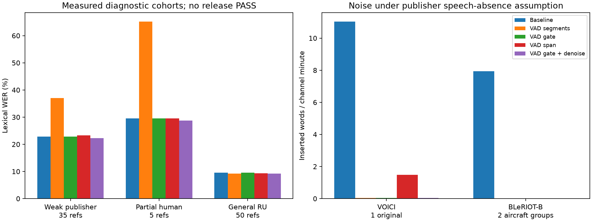

# Дополнительные источники и проверка обработки пауз

**Новые данные действительно получены и использованы. Рабочий baseline сохранён; общий ASR/NLP quality gate — NEEDS_MORE_DATA.**

- BLeRIOT-B: все 7 файлов, 5 архивов, 102 проверенных WAV/NPY; шумовая часть дала 87 отдельных каналов. Микрофоны и каналы коррелированы, группировка консервативно по двум самолётам. Импульсные отклики проверены как данные, но не выданы за новые независимые голоса.
- Google FLEURS: официальный RU dev, tar/TSV проверены по pinned checksums; 50 фраз выбраны по seed/hash до ASR. Это общая русская речь. Идентификаторов говорящих нет: один консервативный кластер, без заявления о кабинном RU качестве.
- Noort CVR: получены 21626 строки с человеческими исходными метками; строгий отбор CVR/CAM/HOT/INT/экипажа оставил 3281 реплику. Train/dev/holdout: 2838/394/49 реплик, 24/7/1 случая. Это отдельная текстовая задача safety voice.

Лицензии, HTTP-проверки и причины отказа остальных источников: [source-decisions.json](source-decisions.json). У DLR и EARS нашлись публикации, но не разрешённые выгрузки raw audio/data. Pilot Speech Corpus оказался корпусом банковской биометрии; ICSRC — автомобильной речью.

## ASR: одинаковые модель и precision

**3305 результатов сравнения на 661 входе**: 524 прежних baseline-ответа переиспользованы с проверкой SHA-256, остальные 2781 результаты получены новым исполнением стадий. Фактических новых вызовов ASR: 4022; пустых выходов без вызова модели после VAD: 980; сбоев исполнения ASR: 0.

Тот же pinned whisper-small parent, фактический CUDA/float16, beam 5, temperature 0, одинаковая информация о языке. Нет эталонных prompts, hints или повторного ASR. VAD segments — прежнее разбиение; gate пропускает исходник целиком при наличии речи; span сохраняет промежуточные паузы и обрезает только внешние, с дополнительным запасом 400 мс; последний вариант добавляет существующий denoise strength 0,3. План всех вариантов заморожен до inference, исходники сохранены отдельно.

| Поднабор (число эталонов) | Baseline WER | Segments | Gate | Span | Gate + denoise |
|---|---:|---:|---:|---:|---:|
| BLeRIOT: слабые чистые эталоны (35) | 22.87% | 37.09% | 22.87% | 23.32% | 22.30% |
| Пять пользовательских dev-расшифровок (5) | 29.57% | 65.22% | 29.57% | 29.57% | 28.70% |
| LibriSpeech EN: общий чистый контроль (50) | 3.62% | 3.46% | 3.62% | 3.54% | 3.62% |
| FLEURS RU: общий контроль (50) | 9.55% | 9.23% | 9.55% | 9.34% | 9.23% |
| Слабые смеси VOICI 0 dB (35) | 64.16% | 100.11% | 64.16% | 78.61% | 54.95% |
| Слабые смеси VOICI 10 dB (35) | 40.73% | 47.78% | 40.73% | 26.17% | 40.05% |

Сценарии после автоматической привязки остаются слабыми эталонами. Все объявленные окна сохранены; для окна без эталона WER не выдуман. Пользовательский dev содержит только три группы и прежнее воздействие подсказок.

| Шум по заявлению издателя | Baseline слов/мин | Segments | Gate | Span | Gate + denoise |
|---|---:|---:|---:|---:|---:|
| VOICI | 11.0381 | 0.0398 | 0.0398 | 1.4916 | 0.0398 |
| BLeRIOT-B | 7.9479 | 0.0000 | 0.0000 | 0.0000 | 0.0000 |

Для BLeRIOT-B знаменатель — сумма длительностей каналов, а не время независимых полётов. Пустой эталон шума опирается на описание издателя; независимой человеческой проверки отсутствия речи нет.

| Вариант | Чистый EN контроль | VOICI / B noise | Цель 10%: слабый dev / человеческий dev | 95% CI ΔWER: человеческий dev |
|---|---|---|---|---|
| VAD segments | PASS | PASS / PASS | FAIL / FAIL | [0.130435; 0.695652] |
| VAD gate | PASS | PASS / PASS | FAIL / FAIL | [0.000000; 0.000000] |
| VAD span | PASS | PASS / PASS | FAIL / FAIL | [0.000000; 0.000000] |
| VAD gate + denoise | PASS | PASS / PASS | FAIL / FAIL | [-0.043478; 0.000000] |

CI: paired cluster bootstrap, 2000 повторов, seed 55, delta = вариант − baseline. Для одного RU кластера и одного источника шума в смесях bootstrap вырожден; статистическая значимость на них не заявлена. Благоприятный диагностический результат не заменяет недостающие независимые кабинные эталоны и критические сущности. **Ни один этап не активирован в release.**

## NLP: реальные человеческие исходные метки

Обучены TF-IDF word/char + logistic regression: 9 вариантов C/threshold и ещё 3 с предыдущей репликой. Контекст включает только предыдущую принятую реплику при последовательных номерах строк; не включает будущее, метки, роль, исход аварии или текст исключённого радиообмена. Сравнение сохранено с прежними project hazard rules и отдельными более широкими фиксированными hazard rules. Выбор выполнен по dev macro-F1, затем зафиксирован перед holdout inference. Размеченные ответы недоступны контейнеру inference.

| Dev, 394 реплики / 7 случаев | Precision safety voice | Recall | F1 safety voice | Macro-F1 |
|---|---:|---:|---:|---:|
| original | 0.2031 | 0.4333 | 0.2766 | 0.5893 |
| context | 0.2340 | 0.3667 | 0.2857 | 0.6042 |
| project_hazard_rules | 0.3750 | 0.1000 | 0.1579 | 0.5576 |
| broad_hazard_rules | 0.2609 | 0.2000 | 0.2264 | 0.5853 |

| Holdout, 49 реплик / 1 случай | Precision safety voice | Recall | F1 safety voice | Macro-F1 |
|---|---:|---:|---:|---:|
| prediction | 0.1111 | 0.2000 | 0.1429 | 0.5000 |
| project_hazard_rules | 0.0000 | 0.0000 | 0.0000 | 0.4731 |
| broad_hazard_rules | 1.0000 | 0.2000 | 0.3333 | 0.6449 |

**NLP результат — INCONCLUSIVE:** один принятый holdout-случай недостаточен для обобщения; на нём обученный вариант уступил широким правилам. После этого результата модель не перенастраивалась. Человеческие coding_safety_voice не переименованы в CHECKLIST, CREW_COORDINATION или проектную значимость. Это классификация текстовой реплики, не temporal event detection; оценки модели не калиброваны.

## Проверка исполнения и воспроизведение

15 контрактных тестов; реальное новое RU/noise CPU исполнение с фактическим int8_float32; все контейнеры inference/training работают без сети. Исторические полные CPU E2E и проверки восстановления не переименованы в новые прогоны.

[Проверка артефактов](verification.json), [полные ASR метрики](asr/comparison.json), [NLP holdout](nlp-final/comparison.json), [замороженный ASR план](asr/plan.json), [CPU smoke](cpu-smoke.json), [PowerShell/Linux пересчёт](score-reproduction.json).

