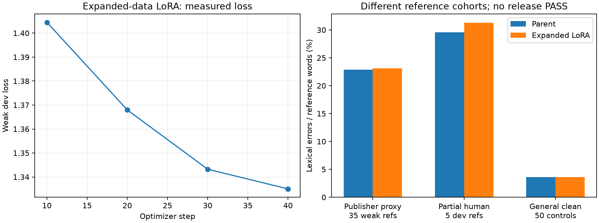

# Расширенный опыт на доступных источниках

Обработано **476 окон BLeRIOT-A/C** по 20 секунд, 9 исходных train-групп и 3 dev-группы.
Строгие условия привязки допустили **33 train / 35 dev** слабых пар. Пороги чисел, anchors и alignment не ослаблялись. В новом опыте дополнительно отклонён любой язык, который alignment-модель не определила как EN.

Рассмотрены все полные окна документированных английских checklist-семейств, включая TBM940. TBM940 не прошёл автоматические условия допуска в обучение; это обработанный источник, а не подтверждённые учебные пары. Конечные хвосты короче 20 секунд перечислены в плане как отложенные. CVR/ATC, французские и неизвестные сценарии в эту EN адаптацию не входят.

**Обучение исполнено:** 40 optimizer steps, rank 8, lr=0.0001, seed 55; 50.015 с на NVIDIA GeForce RTX 5070 Ti. Adapter, merged weights и CT2 conversion сохранены. Родитель — тот же pinned openai/whisper-small. Новый checkpoint получен с нуля от родителя; старый checkpoint не перезаписан.

**Сравнение исполнено:** 1048 локальных GPU/float16 распознаваний, сбоев исполнения ASR в итоговых записях **0**. Настройки обеих моделей совпадают; beam=5, temperature=0, дополнительные ASR стадии отключены. Подготовка смесей использует VAD только для определения SNR, не для обрезки входа ASR.

**Восстановление:** один реальный сбой записи на диск (OSError, Errno 5) прервал опыт после 707 сохранённых ответов. По тому же замороженному плану исполнены оставшиеся 341 распознавания. Проверка SHA-256 подтверждает сохранность прежних ответов. Несохранённый ответ прерванного вызова недоступен; он не выдан за успешное измерение. [Состояние и hashes до восстановления](resumption/attempt-1.json), [исходная ошибка](resumption/interrupted-tail.log). Нулевое число итоговых сбоев исполнения ASR не означает отсутствие инфраструктурного сбоя или ошибок распознанного текста.

| Набор | Всего / с эталоном | Parent: ошибки / слова | Новая LoRA: ошибки / слова | WER до → после |
|---|---:|---:|---:|---:|
| BLeRIOT: слабая издательская привязка | 114 / 35 | 201 / 879 | 203 / 879 | 22.87% → 23.09% |
| Сохранённые человеческие dev-расшифровки | 5 / 5 | 34 / 115 | 36 / 115 | 29.57% → 31.30% |
| LibriSpeech: общий чистый контроль | 50 / 50 | 44 / 1214 | 44 / 1214 | 3.62% → 3.62% |
| BLeRIOT + VOICI, 0 dB (слабые эталоны) | 102 / 35 | 564 / 879 | 480 / 879 | 64.16% → 54.61% |
| BLeRIOT + VOICI, 10 dB (слабые эталоны) | 102 / 35 | 358 / 879 | 238 / 879 | 40.73% → 27.08% |

WER для автоматически привязанных сценариев и их смесей — **proxy несоответствия слабому тексту**. Оценены все объявленные подходящие эталоны; остальные ответы тоже сохранены, но отсутствующий эталон не превращён в нулевую ошибку.

BLeRIOT: слабая издательская привязка: относительное снижение -1.00%; paired cluster bootstrap CI для «новая − parent»: [0.000000; 0.002703], 2 группы, seed 55, 2000 повторов. Диагностический вывод: **FAIL_POINT_TARGET**.
Сохранённые человеческие dev-расшифровки: относительное снижение -5.88%; paired cluster bootstrap CI для «новая − parent»: [-0.021739; 0.043478], 3 группы, seed 55, 2000 повторов. Диагностический вывод: **FAIL_POINT_TARGET**.

**VOICI без добавленной речи:** весь исходник, 50.2806 минут / 151 окон; слов в минуту по пустому эталону издателя: parent **11.0381**, новая LoRA **14.0412**.
Измеренные ограничения: clean **PASS**; noise **FAIL**.

Издатель сообщил об удалении речи из VOICI, но независимое локальное прослушивание отсутствует. Вся шумовая запись назначена только в dev. Во всех смесях один и тот же исходный шум: это одна noise-группа, а не множество независимых полётов. Слабый текст чистой записи не подтверждает разборчивость шумовой смеси. Bootstrap для смесей с одной группой вырожден (одинаковые границы); он не подтверждает статистическую значимость улучшения. Нормальный training augmentation по-прежнему требует проверенного noise scope; диагностические смеси в обучение не переданы.

Чистые LibriSpeech controls и пять пользовательских dev-расшифровок уже просматривались ранее. Они служат регрессионной проверкой; на них не выбирается release. В человеческом поднаборе сохранены подсказки в истории разметки и неуточнённая запись чисел цифрами. Критические сущности и события не размечались машиной под видом человека.

**ASR/NLP/temporal quality gates: NEEDS_MORE_DATA. Candidate не выбран, release не изменён.** Новый опыт не достиг точечной цели 10% на слабом чистом dev и человеческом dev; шумовой диагностический guardrail провален. Отдельные благоприятные числа не дают оснований для полного PASS. Поддержка RU/mixed остаётся технической, качество на них не подтверждено.

Источники и ограничения: [перечень решений](source-decisions.json), [реальные HTTP-проверки](source-audit/retrieval.json). BLeRIOT-A/C и VOICI используются локально с исходными ограничениями лицензий; новых разрешённых аудиопар из HIWIRE, RU, IEM или DLR получить не удалось. Результаты всех доступных источников сохранены; ATC не включён в основную задачу.

Артефакты: [план](evaluation/plan.json), [все метрики и ответы](evaluation/comparison.json), [CSV](evaluation/predictions.csv), [CPU smoke](cpu-smoke.json), [верификация](verification.json).

