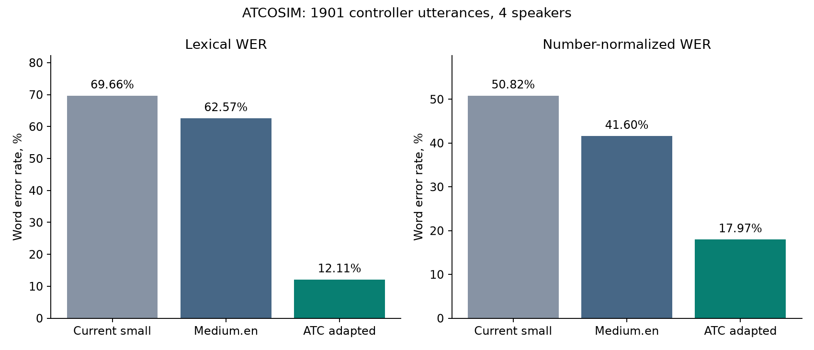

# Авиационная речь: ATCOSIM

Обработаны все **1901 фрагментов** опубликованного тестового набора: **122.74 минуты**, **4 диктора**. Это речь диспетчеров в симуляции. Основной результат относится к авиации; общая речь служит контролем.

Выбран отдельный профиль: **atc_gate**.

Использована готовая сторонняя авиационная адаптация Whisper-medium.en. Новых шагов обучения в этом опыте нет. Исходная medium.en позволяет отдельно оценить вклад авиационного дообучения.

**Для кабинных разговоров этот профиль не подходит:** на пяти проверенных фрагментах WER 13.91% у прежнего small и 86.09% у ATC. Авиационный профиль выбирается явно для английского радиообмена.

## Все варианты

| Вариант | ATCOSIM WER | После симметричной нормализации чисел | Кабина, 5 фрагментов | Кабина, 35 слабых | General EN |
|---|---:|---:|---:|---:|---:|
| small | 69.66% | 50.82% | 13.91% | 22.87% | 3.62% |
| small_gate | 69.66% | 50.82% | 13.91% | 22.87% | 3.62% |
| medium | 62.57% | 41.60% | 27.83% | 25.71% | 3.29% |
| medium_gate | 62.57% | 41.60% | 27.83% | 25.71% | 3.29% |
| atc | 12.11% | 17.97% | 86.09% | 31.74% | 3.95% |
| atc_gate | 12.11% | 17.97% | 86.09% | 31.74% | 3.95% |

Первичная метрика — lexical WER: слова/числа не переписываются под ответ модели. Вторая колонка отделяет часть различий записи чисел; она не заменяет проверку критических сущностей.

| Система | S | D | I | Слов в эталоне | CER |
|---|---:|---:|---:|---:|---:|
| small | 8048 | 6893 | 832 | 22642 | 49.42% |
| medium | 6748 | 7085 | 333 | 22642 | 44.73% |
| atc | 1816 | 378 | 547 | 22642 | 6.84% |

## Авиационные слова и отрицания

| Система | Пропущено/заменено авиационных слов | Пропущено/заменено отрицаний |
|---|---:|---:|
| small | 632 / 2864 | 1 / 5 |
| medium | 505 / 2864 | 0 / 5 |
| atc | 21 / 2864 | 0 / 5 |

Точное восстановление заранее заданных слов при lexical-выравнивании. Это дополнительная диагностика, не разметка смысла команд и не оценка критических сущностей. Список слов не подавался в распознавание и не использовался для выбора модели.

## Проверка по дикторам

| Диктор | Фрагменты | small | medium.en | ATC |
|---|---:|---:|---:|---:|
| sm2 | 202 | 63.82% | 59.99% | 10.20% |
| zf1 | 641 | 71.00% | 66.36% | 11.29% |
| zf2 | 675 | 71.62% | 61.62% | 13.65% |
| zf3 | 383 | 66.68% | 59.53% | 11.49% |

95% paired bootstrap сгруппирован по четырём исходным дикторам. Это описательная оценка на данном корпусе, а не приёмка по прежнему требованию 20 независимых групп.

```json
{
  "atc_vs_small_lexical": {
    "lower": -0.5923466423175895,
    "upper": -0.5476498490728763,
    "method": "paired_cluster_bootstrap",
    "seed": 55,
    "resamples": 2000,
    "confidence_level": 0.95,
    "independent_groups": 4,
    "delta_definition": "candidate - baseline",
    "valid_resamples": 2000,
    "system_intervals": {
      "baseline": {
        "lower": 0.6590484404197211,
        "upper": 0.713292955052598
      },
      "candidate": {
        "lower": 0.1081992337164751,
        "upper": 0.1327963099137643
      }
    }
  },
  "atc_vs_small_canonical": {
    "lower": -0.3452692867540029,
    "upper": -0.3147462686567164,
    "method": "paired_cluster_bootstrap",
    "seed": 55,
    "resamples": 2000,
    "confidence_level": 0.95,
    "independent_groups": 4,
    "delta_definition": "candidate - baseline",
    "valid_resamples": 2000,
    "system_intervals": {
      "baseline": {
        "lower": 0.47805283960890366,
        "upper": 0.5387190684133916
      },
      "candidate": {
        "lower": 0.15810276679841898,
        "upper": 0.19717529770146774
      }
    }
  },
  "atc_vs_medium_lexical": {
    "lower": -0.5399526168425587,
    "upper": -0.48000898472596587,
    "method": "paired_cluster_bootstrap",
    "seed": 55,
    "resamples": 2000,
    "confidence_level": 0.95,
    "independent_groups": 4,
    "delta_definition": "candidate - baseline",
    "valid_resamples": 2000,
    "system_intervals": {
      "baseline": {
        "lower": 0.5965214891476212,
        "upper": 0.650859383589255
      },
      "candidate": {
        "lower": 0.1081992337164751,
        "upper": 0.1327963099137643
      }
    }
  },
  "atc_vs_medium_canonical": {
    "lower": -0.25082236842105265,
    "upper": -0.22596355697371737,
    "method": "paired_cluster_bootstrap",
    "seed": 55,
    "resamples": 2000,
    "confidence_level": 0.95,
    "independent_groups": 4,
    "delta_definition": "candidate - baseline",
    "valid_resamples": 2000,
    "system_intervals": {
      "baseline": {
        "lower": 0.38631162887455794,
        "upper": 0.429680015328607
      },
      "candidate": {
        "lower": 0.15810276679841898,
        "upper": 0.19717529770146774
      }
    }
  }
}
```

## Шум и тихая речь

| Вариант | VOICI, вставок/мин | BLeRIOT-B, вставок/мин | Тихая кабина WER | Тихая общая EN WER |
|---|---:|---:|---:|---:|
| small | 1.80 | 9.58 | 14.78% | 1.45% |
| small_gate | 0.00 | 0.00 | 14.78% | 1.45% |
| medium | 0.60 | 8.98 | 20.87% | 1.45% |
| medium_gate | 0.00 | 0.00 | 20.87% | 1.45% |
| atc | 19.20 | 42.50 | 86.96% | 2.90% |
| atc_gate | 0.00 | 0.00 | 86.96% | 2.90% |

Шум в этом опыте распознаётся с явным English; сравнение с прежними auto-language числами некорректно. Gate пропускает весь вход при наличии речи, поэтому не обещает убрать шумовые паузы внутри длинной записи.

## Происхождение и ограничения

Автор адаптации указывает ATCO2-1h и UWB-ATCC как источники дообучения; ATCOSIM не указан. Это основание для проверки переноса между корпусами, но полный внешний train-манифест отсутствует. Пересечение с исходным pretraining Whisper неизвестно. Локальные train WAV проверены на точные пересечения.

В зеркале корпуса лежат WAV 32 кГц, хотя декодируемая Hugging Face Audio feature объявляет 16 кГц. Исходные bytes сохранены; для всех трёх моделей подготовлен один и тот же mono float32 PCM 16 кГц.

Это не доказательство качества реального шумного VHF радиообмена, русской авиационной речи или всей кабинной задачи. Человеческая проверка критических сущностей и целевые NLP-события не добавлены. **Полный прежний SPEC: NEEDS_MORE_DATA.**

[Область](../../docs/aviation_scope.md) · [Протокол](protocol.md) · [Метрики](metrics.json) · [Примеры улучшений и ухудшений](examples.md) · [Локальный запуск](../../docs/aviation_local.md)

Источники: [ATCOSIM](https://www.spsc.tugraz.at/databases-and-tools/atcosim-air-traffic-control-simulation-speech-corpus.html), [зеркало](https://huggingface.co/datasets/Jzuluaga/atcosim_corpus), [авиационная модель](https://huggingface.co/jacktol/whisper-medium.en-fine-tuned-for-ATC).



## Проверка исполнения

450 тестов; Ruff и Mypy пройдены. 6135 GPU ASR-вызовов завершены без ошибок. Отдельно выполнены 2 полных CLI-запуска: тексты и таймкоды слов совпали с экспериментом, хеш выбранного рецепта подтверждён. Повторный подсчёт метрик и рецепта без ASR: **PASS**, побайтное совпадение. Подмена сохранённой гипотезы в отдельной копии отклонена проверкой целостности.

[Тесты](code-verification.json) · [CLI](runtime-verification.json) · [Повторный подсчёт](score-replay.json) · [Проверка подмены](integrity-rejection.json)
