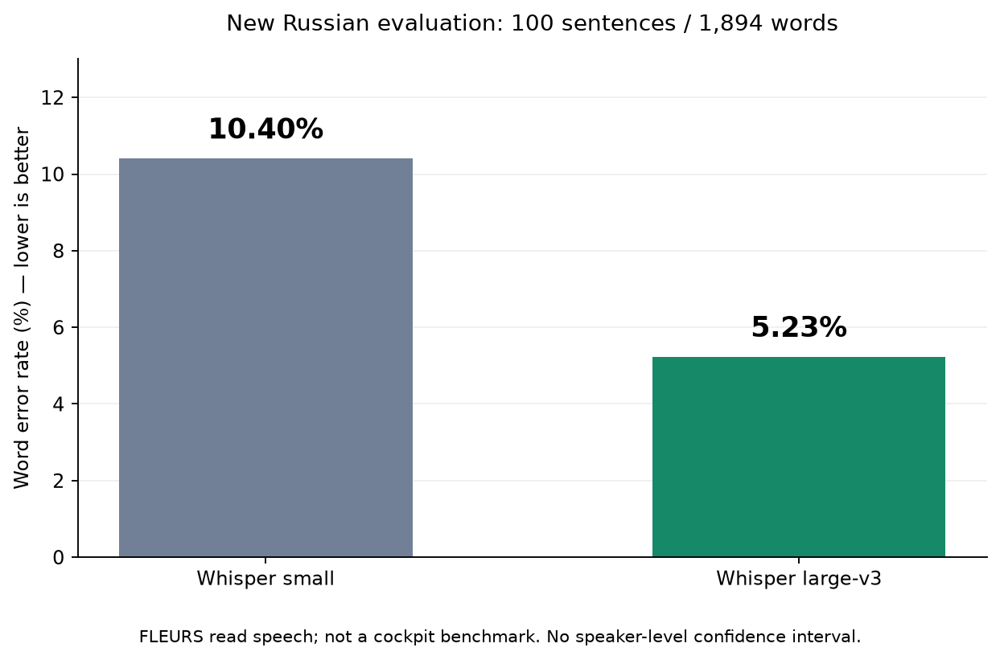

# Практическое улучшение распознавания: результат

Исследование выполнено локально через Docker Compose без сети и нового обучения.
Новая RU-проверка: **10.40% → 5.23% lexical WER**,
относительное снижение **49.75%**.
Это эффект выбора **Whisper large-v3 вместо small**, не эффект LoRA или предобработки.
Выбранный английский вариант: **small**.

## Новые данные и независимость

Из 356 локальных FLEURS dev-записей исключены все предложения прежних 50 controls
и sentence IDs полного локального train. Осталось 237 записей со 100 новыми
предложениями: заранее по hash имени выбрано одно чтение каждого предложения;
137 остальных чтений показаны отдельно. Новая основная выборка — 19.56 минуты,
**1894 слов**, готовые человеческие тексты издателя.
Новой местной ручной разметки не было. Аудио сверено с TSV и checksums; известных
пересечений waveform с train не обнаружено. Пересечение с pretraining Whisper
неизвестно. Отдельный новый закрытый final test не создавался и старый не открывался.

Выбор large-v3 для RU сделан до просмотра новых ответов, по старой диагностике.
Это новая проверка на ранее не оценивавшихся предложениях, но дикторы неизвестны:
нельзя утверждать независимость от дикторов старого dev или строить надёжный
speaker/session CI. Условный bootstrap по предложениям сохранён в metrics.json
и не заменяет требуемую SPEC оценку по независимым группам.

## Измерения выбранного рецепта

| Набор | Записей | Исходный small | Выбранный вариант |
|---|---:|---:|---:|
| Новый RU: одно чтение каждого нового предложения | 100 | 10.40% | 5.23% |
| Новый RU: дополнительные чтения | 137 | 10.22% | 4.39% |
| Прежний RU-контроль | 50 | 9.55% | 5.21% |
| Человеческий кабинный dev | 5 | 13.91% | 13.91% |
| Общий EN-контроль | 50 | 3.62% | 3.62% |
| Слабые кабинные эталоны | 35 | 22.87% | 22.87% |

Корпусный WER = сумма S+D+I / сумма N. В новой основной RU-выборке:
small S/D/I = **157/21/19**;
large S/D/I = **83/11/5**.
Ошибок исполнения на ней: small 0, large 0.
Общие EN/RU controls не доказывают качество разговоров экипажа. Кабинный human dev
по-прежнему содержит только пять фрагментов/115 слов/три ранее просмотренные группы.
Сценарные тексты остаются слабыми эталонами. Сравнивать их WER с человеческим gold
как равнозначные показатели нельзя.

| Шум с языком auto, вставок/мин | Исходный small | Готовый рецепт |
|---|---:|---:|
| noise_only | 6.800 | 6.800 |
| bleriot_b_noise | 4.589 | 4.589 |

Шумовые запросы имеют язык auto и в готовом рецепте проходят через исходный small.
Они не подтверждают поведение large при принудительно заданном RU на чистом шуме.

## Все восемь заранее объявленных вариантов

| Вариант | Human cockpit WER | Общий EN WER | Оба noise guards | Все условия EN-выбора |
|---|---:|---:|---|---|
| small | 13.91% | 3.62% | True | False |
| small_gate | 13.91% | 3.62% | True | False |
| small_glossary | 18.26% | 3.62% | True | False |
| small_glossary_gate | 18.26% | 3.62% | True | False |
| large | 17.39% | 6.10% | False | False |
| large_gate | 17.39% | 6.10% | True | False |
| large_glossary | 14.78% | 9.06% | False | False |
| large_glossary_gate | 14.78% | 9.06% | True | False |

Словарь содержит до 48 слов из train, без test/dev текстов и числовых ответов.
Фильтр gate при наличии речи сохраняет исходное окно целиком; при отсутствии
обнуляет текст. Результат фильтра вычислен из сохранённых VAD-интервалов: он не
выдаётся за новый независимый ASR-вызов. Выполнено **1000 новых GPU ASR-вызовов**;
идентичные запросы без EN-словаря переиспользованы по hashes. Точность CUDA float16,
beam 5, temperature 0. Начальные задержки проверки/загрузки моделей сохранены в
execution.json и не являются временем распознавания одного фрагмента.

## Использование и статус

Подготовлен [готовый рецепт](recipe/selected.json) и отдельная команда обработки
локальных файлов: [инструкция](../../docs/improved_local.md).
RU маршрутизируется в large только при явном --language ru. Auto/mixed сохраняют
small. Результат содержит исходный ASR-текст, таймкоды и черновые события; это не
подтверждённые действия экипажа. Существующий API/worker не переключались.

Проверки кода: 443 теста прошли, 9 integration/real-ASR тестов не запускались
в этом наборе. Mypy и Ruff прошли. Отдельно реально выполнены два сквозных
GPU-запуска нового CLI: RU и EN; тексты совпали с сохранёнными ASR-ответами
после нормализации пробелов. [Проверки runtime](runtime-verification.json),
[проверки кода](code-verification.json).

**Полный SPEC: NEEDS_MORE_DATA.** Нет достаточного независимого cockpit-test,
проверенных critical entities, новых event/salience/temporal меток. Новый измеренный
результат относится к общей русской читаемой речи. Дополнительного обучения — 0 шагов.

[Протокол](protocol.md) · [Метрики](metrics.json) · [Зафиксированный план](inference/plan.json)

Готовые тексты FLEURS описаны в [карточке авторов](https://huggingface.co/datasets/google/fleurs).
Исполнение использует локальные закреплённые веса и
[faster-whisper](https://github.com/SYSTRAN/faster-whisper); сетевой доступ при обработке выключен.
