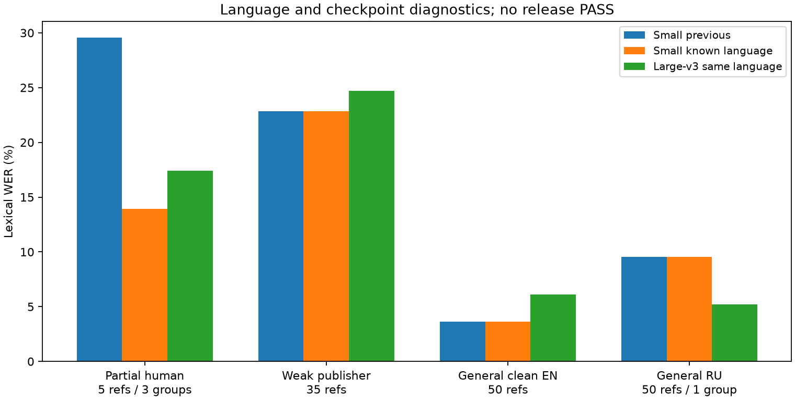

# Проверка EN и Whisper large-v3

**Обе проверки исполнены. Это development-диагностика; release baseline сохранён. ASR quality gate — NEEDS_MORE_DATA.**

## Что сравнивалось

План зафиксирован 2026-09-14T07:33:07.402110+00:00. Сохранены 661 прежний small-ответ; заново выполнены 661 small и 661 large-v3 распознавания. Всего 1983 записи сравнения, 1322 новых вызова. Все входы сохранены, включая окна без эталона и шум.

В пяти пользовательских dev-ревизиях уже был указан EN при подтверждённой области и прослушивании; старый эксперимент передавал auto. Новый языковой вариант использует именно эти сохранённые отметки. Остальные 656 входных режимов не менялись: слабым BLeRIOT эталонам английский не назначался по тексту, русский контроль остаётся RU, неизвестные и шумовые записи остаются auto.

1. **Эффект языка:** прежний small/auto → новый small с EN по отметкам. Меняется доступная языковая информация.
2. **Эффект модели:** новый small → large-v3, одинаковая языковая информация и CUDA/float16. Меняется checkpoint.

Ни одно из этих сравнений не объявляется доказательством улучшения обработки при неизменных checkpoint и входной информации. Два новых варианта исчерпали зафиксированный бюджет 16; дообучение и дополнительный поиск не выполнялись.

Модель large-v3: [Systran conversion](https://huggingface.co/Systran/faster-whisper-large-v3), MIT, revision edaa852ec7e145841d8ffdb056a99866b5f0a478. Все 6 файлов проверены по publisher LFS SHA-256 / Git blob SHA-1; model.bin SHA-256 69f74147e3334731bc3a76048724833325d2ec74642fb52620eda87352e3d4f1. Beam 5, temperature 0, цель transcribe; VAD, denoise, hints и re-decode отключены. Обе GPU модели работали последовательно без сети.

## Измеренное качество

| Поднабор / эталонов | Прежний small | Small с языком | Large-v3 с тем же языком |
|---|---:|---:|---:|
| Слабые издательские эталоны / 35 | 22.87% | 22.87% | 24.69% |
| Пять пользовательских dev-эталонов / 5 | 29.57% | 13.91% | 17.39% |
| Общий чистый EN / 50 | 3.62% | 3.62% | 6.10% |
| Общий RU / 50 | 9.55% | 9.55% | 5.21% |
| Слабые смеси 0 dB / 35 | 64.16% | 64.16% | 40.84% |
| Слабые смеси 10 dB / 35 | 40.73% | 40.73% | 34.81% |

| Эффект на пяти пользовательских фрагментах | Относительное снижение WER | 95% CI ΔWER, процентные пункты |
|---|---:|---:|
| Язык: small auto → small EN | 52.94% | [-28.26; -6.52] |
| Модель: small → large, тот же EN | -25.00% | [0.00; 8.70] |

Пользовательский dev содержит 5 фрагментов, 3 группы и 115 слов; подсказки показывались при разметке, запись чисел и отдельные языковые места остаются ограничением эталона. Текст и нормализатор не исправлялись под результат. Издательские пары имеют слабую автоматическую привязку; RU не имеет speaker IDs и образует один консервативный кластер.

| Шум по описанию издателя | Small, слов/мин | Large-v3, слов/мин |
|---|---:|---:|
| noise_only | 11.0381 | 46.4593 |
| bleriot_b_noise | 7.9479 | 19.9509 |

Шум оценивается по пустому эталону издателя, без независимой проверки отсутствия речи. BLeRIOT-B измерен в канало-минутах, а не независимых полётах.

Paired cluster bootstrap: 2000 повторов, seed 55, 95% CI для candidate − baseline. Числа, размеры групп и интервалы приведены в [comparison.json](comparison.json) и [diagnostic-gates.json](diagnostic-gates.json). Одногрупповые интервалы на RU и смесях не интерпретируются как статистическое подтверждение. Для пустых шумовых эталонов WER-интервала нет даже при двух группах; [ci-interpretation.json](ci-interpretation.json) уточняет групповой флаг замороженного scorer без изменения метрик.

## Время и память

| Свежий GPU запуск | ASR, с | ASR RTF | Driver RTF |
|---|---:|---:|---:|
| small_known | 556.39 | 0.0481 | 0.0482 |
| large_known | 542.60 | 0.0469 | 0.0470 |

| Поднабор | Small ASR RTF | Large ASR RTF |
|---|---:|---:|
| bleriot_b_noise | 0.0559 | 0.0302 |
| Общий чистый EN | 0.0274 | 0.0736 |
| Общий RU | 0.0303 | 0.0664 |
| noise_only | 0.0924 | 0.0381 |
| Пять пользовательских dev-эталонов | 0.0139 | 0.0405 |
| Слабые издательские эталоны | 0.0306 | 0.0510 |
| Слабые смеси 0 dB | 0.0312 | 0.0526 |
| Слабые смеси 10 dB | 0.0257 | 0.0484 |

RTF = время обработки / длительность аудио. ASR RTF исключает инициализацию, очередь и UI; driver дополнительно учитывает чтение/проверку аудио. Это не end-to-end время приложения.

| Запуск | Инициализация, с | GPU до модели, MiB | Наблюдённый максимум GPU, MiB | Максимум RSS процесса, MiB |
|---|---:|---:|---:|---:|
| small_known (COMPLETED) | 0.98 | 2833 | 4176 | 1160.4 |
| large_known (COMPLETED) | 4.32 | 2786 | 7410 | 3255.0 |

GPU память опрашивалась с целевым шагом 0,5 с через nvidia-smi. Это память всего устройства, включая другие приложения; краткие пики между опросами могут быть пропущены. RSS относится к CPU памяти процесса.

Совпадение новых small-ответов с прежними на неизменных языковых режимах: 656/656. Ошибки вызовов ASR: {'small_previous': 0, 'small_known': 0, 'large_known': 0}.

## Статус и воспроизведение

Независимый кабинный final test и критические сущности по-прежнему отсутствуют в необходимом объёме. Candidate не выбран, serving baseline и пользовательские ревизии сохранены; результаты не заменяют NLP/temporal gates.

[Тексты пяти фрагментов](human-fragments.md) · [Протокол](protocol.md) · [замороженный план](plan.json) · [CPU smoke](cpu-smoke.json) · [проверки артефактов](verification.json) · [PowerShell/Linux replay](score-reproduction.json).

