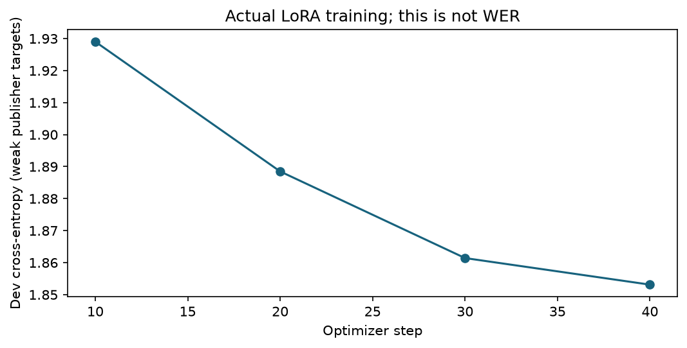

# Эксперимент на готовых текстах BLeRIOT

**Статус научной приёмки: NEEDS_MORE_DATA. Candidate не выбран, release не изменён.**

Подготовлены 76 фрагментов: 8 train и 3 dev speaker-группы. Автоматические проверки допустили 17 train и 7 dev пар. Тексты взяты из документов издателя; колонки PDF восстановлены по координатам. Сопоставление и таймкоды получены автоматически. Человеческие метки не создавались.

LoRA: small, rank 8, 40 optimizer steps, 8 epochs, NVIDIA GeForce RTX 5070 Ti; обучение 52.805 с. Первый запуск остановился на 0 шагах из-за второй несовместимой GPU; успешная попытка использует только GPU 0. Сохранены adapter, merged Transformers checkpoint, CT2 float16 и настоящие предсказания. Сравнение использует исходную и адаптированную модель из одного Transformers checkpoint, одинаковую CT2 conversion и float16 decoding.

| Измерение | Исходная | После LoRA | Ограничение |
|---|---:|---:|---|
| Расхождения с автоматически привязанным текстом | 70/178 (39.33%) | 57/178 (32.02%) | 7 из 24 dev-фрагментов; 3 группы; это не независимый gold |
| WER общеречевых контролей | 0/30 (0.00%) | 0/30 (0.00%) | 2 записи; 1 группа; недостаточно для acceptance |

Снижение расхождений с издательским текстом: **18.57%**. Оно не доказывает требуемое снижение истинного lexical WER: выбор и привязка этих текстов используют родственное ASR. Есть повторяющиеся сценарии и парные clean/noisy варианты. Разбивка по условиям сохранена отдельно; число файлов не выдаётся за число независимых групп.

Все 52 распознавания (24 dev + 2 контроля для каждой модели) сохранены, ошибок исполнения: 0. Отсутствующие эталоны 17 dev-фрагментов не заменены машинными гипотезами и не засчитаны как успешные ответы.

Аналогично рассчитана диагностическая таблица для восьми прежних ablation-вариантов на общей доступной подвыборке. Это вторичный proxy-анализ старых прогонов, не новый scored dev-search. Ни один дополнительный этап не активирован.

Критические сущности и NLP/temporal event precision/recall/F1 не измерены: независимых соответствующих меток нет. Final test не открывался. EN/RU/mixed остаются техническими режимами, подтверждённого языкового качества нет.

Артефакты: comparison.json / comparison.csv; dev-condition-proxy.csv; ablation-proxy.csv; training-history.json; training-manifest.json; adapted-cpu-smoke.json; verification.json.
