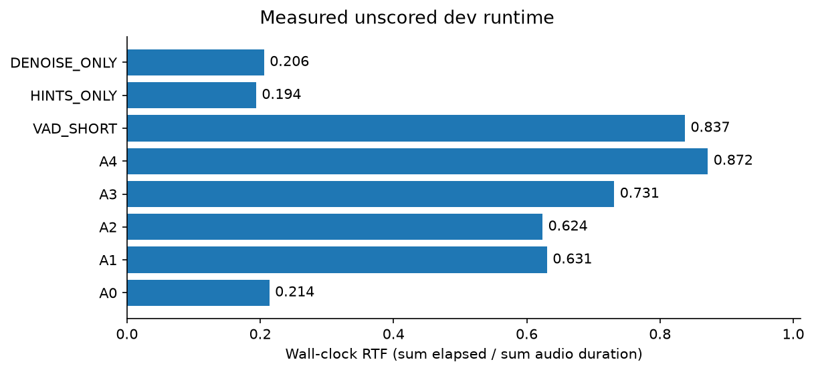

# 55 Север — отчёт измерений

- asr_quality_gate: NEEDS_MORE_DATA
- nlp_quality_gate: NEEDS_MORE_DATA
- temporal_event_gate: NEEDS_MORE_DATA
- selection: NOT_RUN

Отсутствующие значения — **не измерено**, а не ноль. Графики не меняют quality gates.
Качество ограничено зафиксированной выборкой; классификация фрагментов не доказывает temporal detection.

- WER и доверительный интервал: **не измерено** — Нет проверенных измерений.

- WER by language: **не измерено** — Нет проверенных измерений.

- WER by condition: **не измерено** — Нет проверенных измерений.

- Ошибки критических сущностей: **не измерено** — Нет проверенных измерений.

- Multi-label confusion matrices: **не измерено** — Нет человеческих event labels.

- Качество / время: **не измерено** — Нужны WER и полные timing одного cohort.

## Measured unscored dev runtime

Один проход каждой конфигурации. Это измерение скорости; WER/F1 не измерены, candidate не выбран.
